# Shader Skills — GLSL & Shadertoy for AI coding agents

[](https://github.com/gokayfem/shader-skills/actions/workflows/checks.yml)
[](https://github.com/gokayfem/shader-skills/releases/latest)
[](LICENSE)

Shader Skills helps coding agents write, debug and optimize procedural GLSL for Shadertoy and WebGL2. Start with an editable scene, change the lighting or geometry, and bundle it into a single shader. The skill includes **196 GLSL functions across 21 modules**, a dependency bundler and a checker. It works with Claude Code, Codex, Cursor, GitHub Copilot and Gemini CLI.

The full repository includes **25 interactive shader studies** and **two WebGPU worlds**. Use the studies to isolate an effect, then explore how a swimmable kelp forest or a streamed landscape handles visibility, lighting and frame time. [Offline shader viewer](gallery/studies.html) · [WebGPU worlds](worlds/README.md) · [Performance guide](skills/shader-art-coding/references/frame-budgets.md)

```bash
npx skills add gokayfem/shader-skills
```

Choose `shader-art-coding` and your coding agent in the installer. Then ask:

> Create a Shadertoy shader of an alpine valley with snow, a winding river and atmospheric depth.
> Use the shader-art-coding skill, bundle the result into one file, and check it.

[Install options](#install) · [Shader gallery](#shader-gallery) · [Usage](#use) ·
[GLSL library](skills/shader-art-coding/references/library-index.md) ·
[Video-to-shader prompt](prompts/video-to-shader-prompt.md) ·
[Releases](https://github.com/gokayfem/shader-skills/releases) · [Contributing](CONTRIBUTING.md)

## Explore the shader studies

[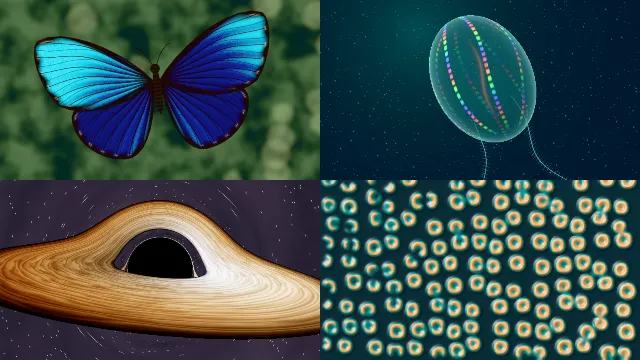](gallery/studies.html)

Open [the self-contained shader viewer](gallery/studies.html) from a local checkout, or download the HTML using GitHub’s **Download raw file** button. It runs offline in a WebGL2 browser. Explore 22 single-pass shaders and three multipass examples. Pause motion, inspect diagnostic views, or switch between fixed resolution and adaptive 30 or 60 fps targets.

| [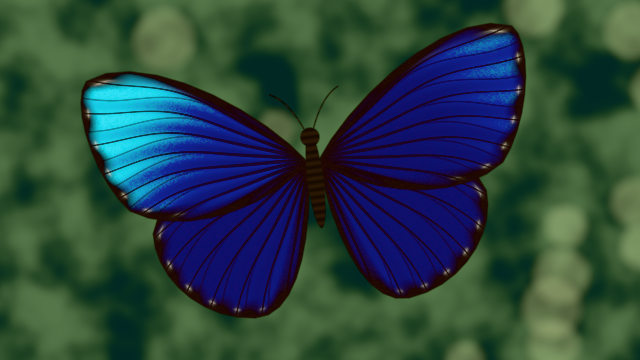](gallery/morpho.glsl) | [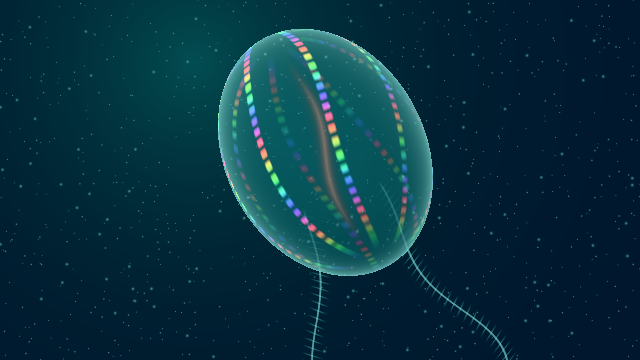](gallery/comb-jelly.glsl) | [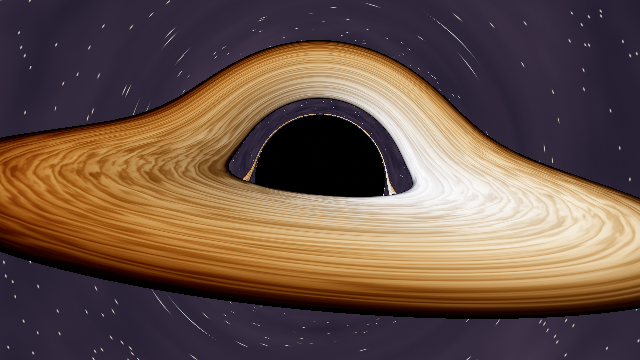](gallery/lensed-disk.glsl) |
|---|---|---|
| **Morpho.** Change the optical period or watch the left and right wings flash as they tilt. | **Comb jelly.** Follow the light along eight rows of beating plates. Turn off the side light to isolate the transparent body. | **Accretion disk.** Lower the camera toward the disk and watch its far side arc over the shadow. Toggle light-path caching. |
| [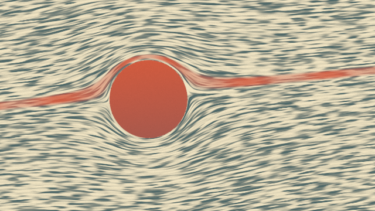](gallery/streamline-press.glsl) | [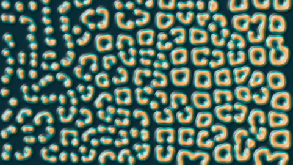](gallery/reaction-diffusion) | [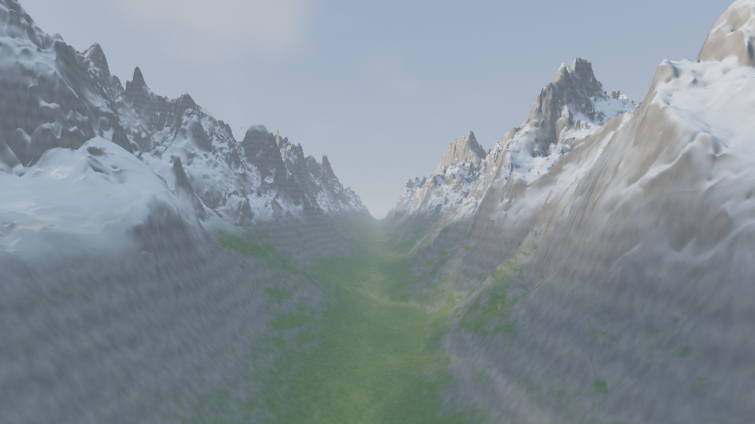](gallery/alpine-cache) |
| **Streamline press.** Paper grain follows a vector field around a vermilion cylinder. Change its radius to move the stagnation points. | **Reaction–diffusion.** Drag to seed a two-channel feedback simulation. Change the feed and removal rates to grow a different pattern. | **Cached alpine valley.** Move the camera over a retained elevation texture. [Three-camera comparison](gallery/alpine-cache/benchmark.md) |

The [research studies guide](skills/shader-art-coding/references/research-studies.md) links the original papers, explains the approximations and gives a second shot to try for each technique.

## Dive, landscape and lighting studies

| [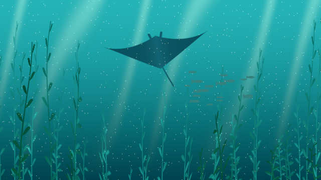](gallery/kelp-passage.glsl) | [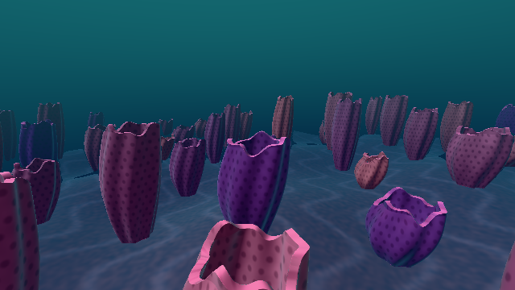](gallery/sponge-shelf.glsl) | [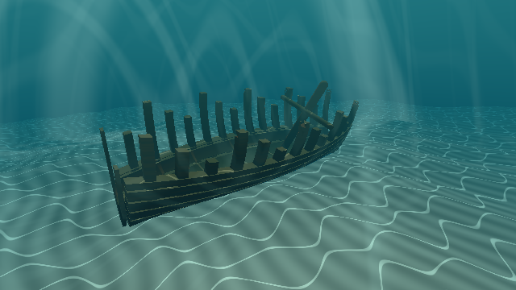](gallery/ribbed-wreck.glsl) |
|---|---|---|
| Kelp passage · current and sun shafts | Sponge shelf · cavities and fluorescence | Ribbed wreck · orbit and dive depth |
| [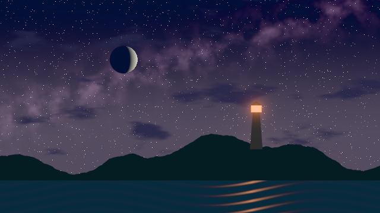](gallery/tide-observatory.glsl) | [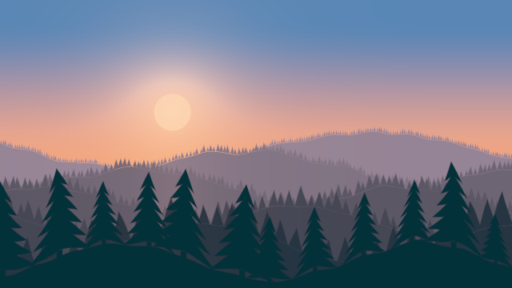](gallery/cloudline-forest.glsl) | [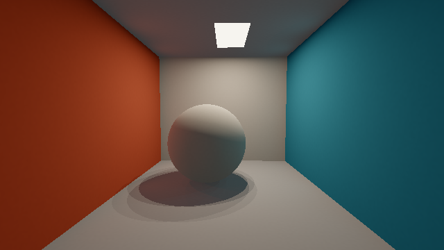](gallery/pigment-chamber.glsl) |
| Tide observatory · hour, clouds, moon phase | Cloudline forest · wind and projected detail | Pigment chamber · lamp position and wall bounce |

Compare the chamber to its [80-patch feedback solver](gallery/room-radiosity) in the [offline viewer](gallery/studies.html). The [world rendering guide](skills/shader-art-coding/references/world-rendering.md) gives a diagnostic experiment for each scene.

The full checkout also contains a [swimmable WebGPU dive](worlds/dive/index.html) and a Rust/WebGPU landscape renderer with a browser editor. Open the [worlds guide](worlds/README.md) for launch instructions and subsystem walkthroughs, or [browse all 541 source files and assets](worlds/catalog.md).

## Measure rendering performance

Where you spend pixels matters. On an Apple M4 in Chrome, reducing the fixed cloud study from 800 × 450 to 480 × 270 cut median image-pass time from **15.00 to 5.55 ms**. The same change saved **0.70 ms** on the wreck. Each figure includes a one-pixel readback and comes from 60 samples per size. [Benchmark method and p95 results](skills/shader-art-coding/references/frame-budgets.md#reproduce-the-gallery-resolution-experiment)

The worlds show how those decisions look in a complete renderer. Trace half-resolution light shafts and distance-based kelp geometry in the dive, or follow cluster rejection and coarse-first streaming in the landscape. [Rendering techniques](skills/shader-art-coding/references/frame-budgets.md) · [Frame pacing at six dive viewpoints](worlds/README.md#desktop-dive-timing)

## Shader gallery

| | | |
|---|---|---|
| [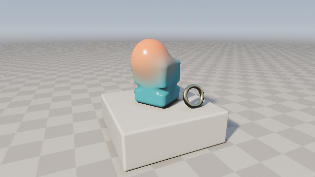](gallery/raymarch-sdf.glsl) | [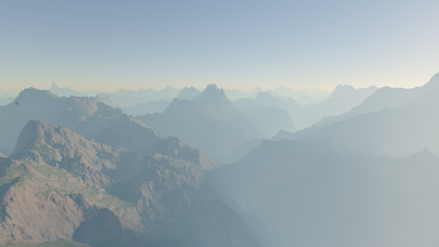](gallery/terrain.glsl) | [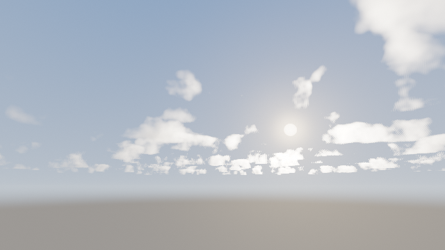](gallery/volumetric-clouds.glsl) |
| SDF still life: smooth blends with blended materials, PBR, soft shadows, AO, AgX | Eroded terrain under a physically based sky with aerial perspective | Volumetric cumulus: energy-conserving integration, Beer-Powder, dual-lobe phase |
| [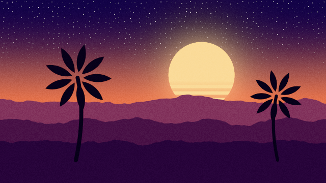](gallery/sdf-2d-poster.glsl) | [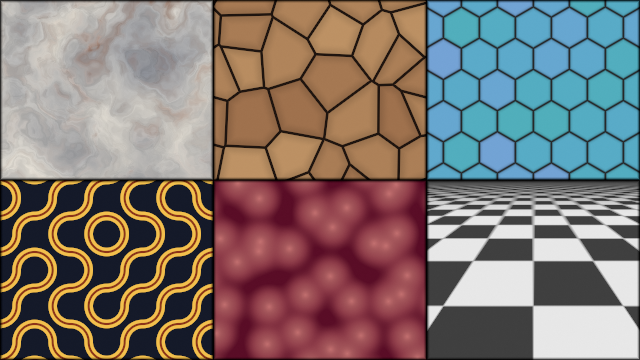](gallery/pattern-swatches.glsl) | [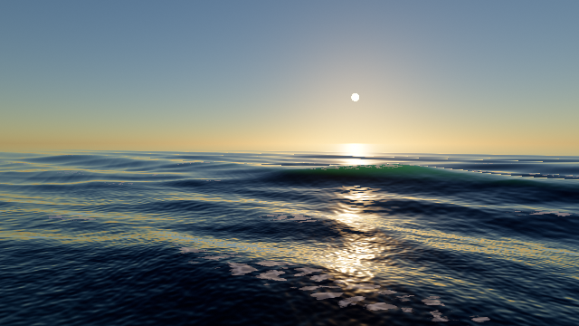](gallery/ocean.glsl) |
| 2D distance-field poster: Oklab gradients, polar leaves, Bézier trunks | Texture-free materials: warped marble, Voronoi cracks, hex tiles, Truchet, filtered checker | Ocean: dispersive waves with analytic curvature foam, Fresnel sky, glitter path widening with distance |

[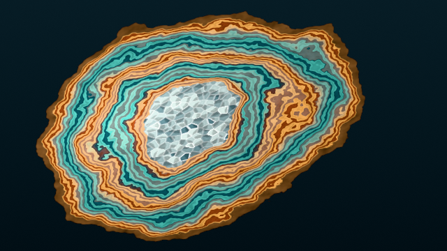](gallery/banded-agate.glsl)

The agate shader combines filtered mineral bands with a faceted quartz pocket. Adjust `BAND_COUNT` to change the
spacing and `BACKLIGHT` to bring out the translucent center. The Voronoi crystal calculation runs inside the pocket.

[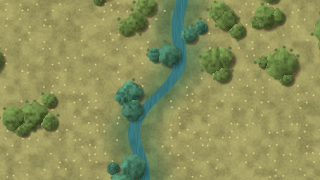](gallery/woodland-edge.glsl)

Open **Woodland Edge** in the offline viewer to widen the wet bank or clear trees and inspect the understory response. [Habitat study](skills/shader-art-coding/references/vegetation-habitats.md)

Each image links to its paste-ready shader. The sources are in [`skills/shader-art-coding/templates/`](skills/shader-art-coding/templates/).

## Why

Coding agents can misremember formulas or skip visual checks, and WebGL rejects code that desktop GLSL accepts.
Common results are struct ternaries, sine hashes that differ per GPU, SDFs with wrong signs,
double gamma, and fog that ignores the sky. This skill closes those gaps:

- **Tested building blocks instead of recalled ones.** Every SDF is checked on the GPU:
  - the Lipschitz bound (safe to raymarch);
  - exactness, by projecting points onto the surface;
  - inside/outside signs;
  - for curves, agreement with brute-force distance.

  Noise derivatives are checked against finite differences, curl noise for zero divergence, color transforms for
  round trips, and intersectors against their SDFs.
- **A bundler,** so the agent writes `sdRoundCone(...)`, `softShadow(...)`, `tonemapAgX(...)` by name and ships one
  self-contained file.
- **A checker** that catches WebGL1 leftovers, sine hashes, `#version` lines and missing `mainImage`, and compiles
  with glslangValidator.
- **A workflow** with a fixed debug-mode convention, so problems are inspected as fields rather than guessed at.
- **Routing** from subjects ("a jellyfish", "snowy mountains") to techniques, templates and formulas.

## Install

**Claude Code** (plugin marketplace):

```bash
claude plugin marketplace add gokayfem/shader-skills
```

```bash
claude plugin install shader-skills@shader-skills
```

For a manual Claude Code installation, copy `skills/shader-art-coding` into `~/.claude/skills/` after cloning the repository (see below).

**Codex, Cursor, Gemini CLI, GitHub Copilot and other supported agents** (via [skills](https://github.com/vercel-labs/skills)):

```bash
npx skills add gokayfem/shader-skills
```

The installer requires Node.js 22.20 or later and installs into the current project by default; add `-g` for a
global installation. See the [skills CLI documentation](https://github.com/vercel-labs/skills) for supported agents.

**Manual installation:** clone the repository first, then copy the skill into your agent's skill directory.

```bash
git clone https://github.com/gokayfem/shader-skills.git
cd shader-skills
```

- **Codex:** copy `skills/shader-art-coding` to `~/.agents/skills/`.
- **Cursor:** copy it to `~/.cursor/skills/`, plus the rule in `adapters/cursor/`.
- **Copilot:** `gh skill install gokayfem/shader-skills shader-art-coding`, plus `adapters/copilot/`.
- **Gemini CLI:** `gemini extensions install https://github.com/gokayfem/shader-skills`.
- **Hermes:** copy it to `~/.hermes/skills/`.

**claude.ai:** download `shader-art-coding-v2.0.0.zip` from the [v2.0.0 release](https://github.com/gokayfem/shader-skills/releases/tag/v2.0.0) and upload it under Settings > Capabilities > Skills. The ZIP also works as a portable skill folder for manual installation.

**ChatGPT, Gemini Gems and other chat tools:** see [`adapters/`](adapters/).

## Use

Ask naturally: *"Make a Shadertoy shader of a glass jellyfish drifting through god rays"*, or *"why does my
raymarcher have holes?"* The skill routes the request, then the agent finds blocks, writes the shader, bundles it
and checks it. From a cloned repository, try the included still-life template:

```bash
python3 skills/shader-art-coding/scripts/glsl_tools.py search petal leaf
python3 skills/shader-art-coding/scripts/glsl_tools.py bundle skills/shader-art-coding/templates/raymarch-sdf.glsl -o /tmp/shader-skills-example.glsl
python3 skills/shader-art-coding/scripts/glsl_tools.py check /tmp/shader-skills-example.glsl
```

What the commands do:
- `search` ranks functions by name, summary and `@use` tags.
- `bundle` resolves dependencies transitively and emits them in declaration order.
- `check` lints the file and compiles it when `glslangValidator` is installed (`brew install glslang` or
  `apt install glslang-tools`).

The command-line tools need Python 3 and use only its standard library. Generated shaders target
**Shadertoy / WebGL2 / GLSL ES 3.00**; HLSL and Unity ShaderLab are outside this skill's scope.

For an existing video reference, start with the [video-to-shader prompt](prompts/video-to-shader-prompt.md),
which guides scene analysis, procedural reconstruction and visual comparison against the clip.

## What's in the library

| Module | Highlights |
|---|---|
| `hash` | PCG integer hashes (`pcg3d`, `pcg4d`): bit-exact across GPUs, no sine; safe integer-input float wrappers |
| `noise` | value, gradient and 2D simplex noise with analytic derivatives, fBm, eroded/ridged/billow fBm, two-level domain warp, hybrid terrain height, curl noise, Voronoi (F1/F2, borders, smooth), interleaved-gradient and R2 dithering |
| `pattern` | box-filtered checker, grid and stripes (alias-free with no supersampling), hex grid with edge distance, Truchet |
| `sdf3d` | 22 primitives including exact capped cone, round cone, cut and hollow spheres, death star, hex prism, link, gyroid, 3D Bézier tube |
| `sdf2d` | 16 primitives including vesica, moon, heart, star, regular polygon, rounded box with per-corner radii, quadratic Bézier |
| `operators` | smooth min/max/subtract (quadratic and C2 cubic), smooth union with material blend weight, chamfer, stairs, engrave, round, onion, extrude, revolve, exact elongate |
| `domain` | repetition (infinite, limited, mirrored), polar sectors, folds, twist and bend with their Lipschitz corrections |
| `architecture` | stable parcel-based building dimensions/roof IDs, box-filtered facade windows that converge to opening area |
| `raymarch` | sphere tracing with distance-relative hit threshold, tetrahedral normals, improved soft shadows, AO, thickness; WebGL-safe loops |
| `shading` | GGX + height-correlated Smith + Schlick, metallic-roughness `shadePBR`, environment BRDF approximation, wrap diffuse, translucency, rim |
| `water` | finite-depth dispersion, analytic wave height/slope/curvature, exact dielectric Fresnel including TIR, RGB Beer-Lambert attenuation |
| `color` / `tonemap` | exact sRGB curves, Oklab / OkLCh mixing, blackbody colors; AgX (default), AgX punchy, Khronos PBR Neutral, ACES fitted, Reinhard |
| `volume` / `atmosphere` | HG, dual-lobe, Rayleigh and Cornette-Shanks phase, energy-conserving `volumeStep`, Beer-Powder, analytic height fog; physically based single-scattering sky, sun disk with limb darkening |
| `camera` / `intersect` / `post` / `debug` | look-at, thin-lens DOF, ortho; analytic sphere/box/plane hits; AA helpers, R2 supersampling offsets, cos⁴ vignette, grain, TPDF dither; distance, normal, id and heat debug views |

The full catalog with signatures, exactness and uses is
[`references/library-index.md`](skills/shader-art-coding/references/library-index.md).

## Noise: from a first field to a game use case

The [noise learning guide](skills/shader-art-coding/references/noise-use-cases.md) covers all ten entries in the
Noise Learning Progression reference: what each means, where its code lives, when to use it, tuning, and links to
author-maintained external implementations. It includes eleven compile-checked recipes and two complete shaders.

| Technique | Call the library | Use it for |
|---|---|---|
| Perlin-style gradient | `gradientNoise`, `gradientNoiseD` | Broad hills, weather masks, surface normals |
| Voronoi | `voronoiBorder`, `smoothVoronoi` | Rock plates, constant-width cracks, cell walls |
| Simplex | `simplexNoise`, `simplexNoiseD` | Ripples, rotating-gradient flow, churning lava |
| Fractal / fBm | `fbm`, `erodedFbm` | Multiscale terrain, clouds, slope-damped detail |
| Domain warp | `warpedFbm` | Marble, agate, distorted terrain and cloud bands |
| Value | `valueNoise`, `valueNoiseD` | Cheap smooth masks; quantize inputs for retro blocks |
| Cellular / Worley | `voronoi` F1/F2 and cell IDs | Biome regions, foam, per-stone variation |
| Ridged | `ridgedFbm` | Mountain crests, canyons, rocky veins |
| Billow | `billowFbm` | Puffy smoke, cumulus lobes, rounded terrain |
| Hybrid | `hybridTerrainHeight` | Bounded heightmaps combining warped hills, ridges and cells |

These functions are in [`noise.glsl`](skills/shader-art-coding/glsl/noise.glsl). Voronoi and Worley refer to the
same cellular family here; fBm and domain warping compose base fields. Simplex performance depends on implementation
and target hardware. The guide distinguishes smooth value noise from blocky hashes and designed river masks from
hydrological simulation.

| [](gallery/noise-progression.glsl) | [](gallery/noise-terrain-map.glsl) |
|---|---|
| Top: gradient, Voronoi borders, simplex, fBm, marble warp. Bottom: smooth value, F2−F1 cellular, ridged, billow, hybrid. | Putting it together: warped hills, ridged mountains, cellular breakup, slope-based materials and a designed river channel. |

Click a preview for the standalone Shadertoy shader. Editable sources:
[`noise-progression.glsl`](skills/shader-art-coding/templates/noise-progression.glsl) and
[`noise-terrain-map.glsl`](skills/shader-art-coding/templates/noise-terrain-map.glsl).

## Procedural buildings, terrain and water

Three complete, texture-free starting points cover construction, landscape and shallow-water optics. Each has
art controls, inspectable debug modes, a standalone Shadertoy bundle and a rendered preview.

| [](gallery/procedural-city.glsl) | [](gallery/alpine-valley.glsl) | [](gallery/coastal-water.glsl) |
|---|---|---|
| Parcel-based masses, podiums/setbacks, varied roofs, filtered occupied windows, AO, shadows and height fog. | Designed valley, eroded/ridged terrain, snow by slope/altitude, rock strata, grass and atmospheric depth. | Analytic waves, refracted seabed, reflected land, exact Fresnel, RGB depth absorption, shore foam and three quality presets. |

- **[Procedural buildings](skills/shader-art-coding/references/procedural-buildings.md):** massing hierarchy,
  deterministic parcels, neighbor-safe repetition, facade filtering, geometry versus material detail, and mesh/engine integration.
- **[Terrain production](skills/shader-art-coding/references/terrain-production.md):** heightfields versus density,
  silhouette/detail separation, primary-trace refinement, biome masks, chunk coordinates, seams and LOD.
- **[Water quality](skills/shader-art-coding/references/water-quality.md):** shallow coast versus open ocean,
  reflection/refraction paths, finite-depth waves, filtering, quality presets, and the extra renderer/simulation
  systems needed for film or production water. The existing [open-ocean shader](gallery/ocean.glsl) remains available.

The coastal example uses `QUALITY` 1/2/3 for sky reflection, reflected-land rays, and a four-sample still preset
with more waves/steps. It is a single-pass visual study: foam, in-scattering and caustics include artistic
approximations; it does not simulate breaking surf or FFT ocean spectra. The guides identify implemented features
and limits rather than promising a universal “highest quality” or frame rate.

Sources are in [`templates/`](skills/shader-art-coding/templates/). Bundle with `glsl_tools.py bundle` as above.
All three water presets and every annotated diagnostic view are compiled and rendered by the harness.

## Verification

| Check | Where | What it proves |
|---|---|---|
| Lint + drift | `glsl_tools.py check` | docs and tags on every function, module order, no WebGL1 or sine-hash patterns, reference snippets identical to the library |
| glslang compile | CI (`checks.yml`) | every library module, reference snippet and template compiles as GLSL ES 3.00 |
| WebGL2 compile | `tests/` harness | all library/reference/template units and annotated quality/debug variants compile under ANGLE, which also enforces WebGL-only rules |
| GPU property tests | `tests/properties.py` | 100 tests × 16,384 samples: Lipschitz, exactness, signs, brute-force curve distance, derivatives, divergence, ranges, round trips, facade filtering, water dispersion/Fresnel/attenuation |
| Renders | harness + gallery | 22 beauty templates plus 28 quality/debug variants; no NaNs or black frames; beauty PNGs saved to `gallery/` |
| Bundler regressions | `tests/test_bundler.py` | conditional quality macros cannot hide dependencies; annotated variants replace the intended define and reject missing defines |
| Skill effect | `evals/` (`claude plugin eval`, paid, manual) | output-rule adherence with the skill vs without it on 6 shader tasks, plus no false triggers on 3 near-miss tasks; see [evals/README.md](evals/README.md) |

Run it locally: `python3 tests/build_harness.py && python3 tests/serve.py`, then open
`http://127.0.0.1:8765/build/harness.html`. Headless: `python3 tests/run_webgl.py` (needs Playwright).

To measure a shader change, run `python3 tests/run_webgl.py --benchmark --size 320x180` on both revisions with
the same browser, renderer and resolution. Each beauty shader gets one warm-up draw and seven timed draws at
the same animation time. The JSON records all seven samples and their median in milliseconds, including pixel readback.

## Conventions

- `#define DEBUG_MODE 0`: 0 final, 1 distance field, 2 normals, 3 ids, 4 steps, 5 masks, 6 lighting terms.
- Scene contract `vec2 map(vec3 p)` returns `vec2(distance, materialId)`.
- Color pipeline:
  1. Light in linear color.
  2. Apply exposure.
  3. Tonemap each AA sample.
  4. Average the samples.
  5. Encode once with `linearToSrgb`.
  6. Dither.

## Repository

```text
skills/shader-art-coding/   the skill: SKILL.md, glsl/ library, templates/, references/, scripts/glsl_tools.py
tests/                      WebGL2 harness, GPU property tests, gallery builder, headless runner
evals/                      plugin eval suite: with vs without the skill
gallery/                    offline viewer, rendered previews and paste-ready shader bundles
worlds/                     WebGPU dive, landscape engine, launch instructions and source catalog
adapters/                   prompts for tools without skill support
.claude-plugin/             Claude Code plugin + marketplace manifests
```

See [CONTRIBUTING.md](CONTRIBUTING.md) to report a bug, suggest a shader technique or contribute a fix.
[AGENTS.md](AGENTS.md) defines the checks every library change must pass.
Release history and downloads are in the [changelog](CHANGELOG.md) and
[GitHub Releases](https://github.com/gokayfem/shader-skills/releases).

## Credits and license

MIT. The GLSL library contains original implementations of published techniques. The two WebGPU worlds retain their own MIT notices. Library sources are listed in
[CREDITS.md](CREDITS.md): Inigo Quilez's articles, hg_sdf, Jarzynski & Olano's GPU hash study, Hillaire's
atmosphere and volume work, AgX, Khronos PBR Neutral, Oklab and others.
