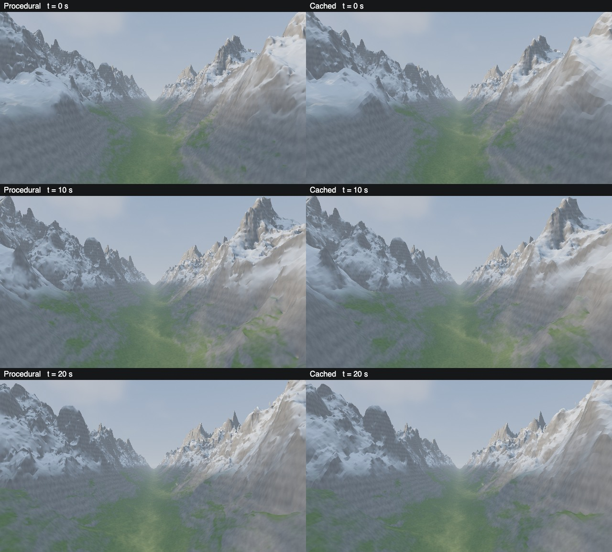

# Alpine height cache comparison

Both columns use the alpine camera, lighting and shaders from this branch. The left evaluates terrain procedurally. The right samples a retained 1536 × 1536 RGBA16F height atlas. The fixed atlas occupies 18 MiB. A feedback host uses a second texture for the copy.

| Camera time | Procedural | Retained atlas | Speedup | Mean RGB error | 95th percentile error |
|---|---:|---:|---:|---:|---:|
| 0 s | 676.0 ms | 359.8 ms | 1.88× | 1.87 | 9 |
| 10 s | 685.8 ms | 364.5 ms | 1.88× | 2.23 | 10 |
| 20 s | 758.1 ms | 410.5 ms | 1.85× | 2.25 | 11 |

One local run on Chromium ANGLE SwiftShader at 640 × 360. Each time is the median of five paired draws after warm-up with full-frame readback. The bake took 172.2 ms. Shadertoy-style copying took 22.6 ms on this machine. Add that cost per displayed frame on feedback hosts. The standalone viewer retains the texture directly.

Errors are absolute differences in 8-bit RGB channels. Interpolation affects fine details, especially normals and snow on steep ridges. The table uses uncompressed readbacks. The comparison image is a JPEG preview. [Raw timing samples](timings.json)

Run `python tests/compare_alpine_cache.py` to regenerate the images and measurements on your renderer.
